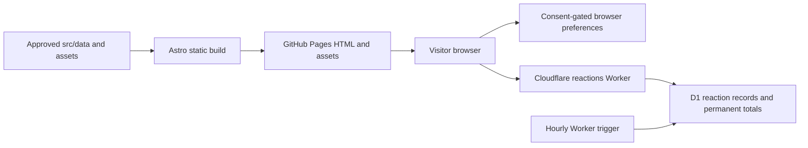

# Daysforth architecture

This is the maintained design of the source tree. Publication and live configuration require
separate deployment receipts; prepared changes here do not establish production behavior.
Read it with [the architectural review](review.md), [the 1.1.1 audit](audit-1.1.1.md), [maintenance rules](maintenance.md), and
[release process](../governance/releases.md). Source and tests remain authoritative for exact behavior.

The [1.1.2 hardening ledger](audit-1.1.2.md) records the latest verified changes and remaining
visibility/growth limits. Build receipts describe source attribution; they do not prove publication.

## System boundaries

The site has two deployment units. GitHub Pages serves static HTML, CSS, JavaScript, fonts, and images.
A separate Cloudflare Worker and D1 database provide shared reaction counts. The website is readable
without JavaScript or the Worker; local saves and enhanced browsing require JavaScript. No visitor
account, application session server, analytics service, service worker, or uploaded-content pipeline
exists in this architecture.

## Source responsibilities

| Boundary                        | Owns                                                                                | Must not own                                                    |
| ------------------------------- | ----------------------------------------------------------------------------------- | --------------------------------------------------------------- |
| `src/data/`                     | Approved personal content, timeline IDs, photo references, policy and release copy  | DOM behavior, unconfirmed facts, secrets                        |
| `src/pages/`, `src/components/` | Static routes, semantic HTML, responsive presentation                               | Independent copies of personal content or behavioral algorithms |
| `src/layouts/BaseLayout.astro`  | Shared landmarks, metadata integration, dialogs and client entry                    | Individual page content                                         |
| `src/lib/`                      | Tested date/model/URL functions, browser controls, reaction wire client and service | Deployment credentials or invented content                      |
| `src/scripts/`                  | Small progressive-enhancement entry points and deferred loading                     | A second domain model                                           |
| `src/styles/`                   | Feature-owned presentation, responsive states, and shared interface foundations     | Competing global overrides of another feature’s layout          |
| `scripts/`, `scripts/lib/`      | Thin CLI entry points and tested repository policies                                | Site runtime behavior                                           |
| `workers/reactions/`            | Worker binding adapter, D1 migrations, scheduled cleanup, deployment config         | Raw visitor identifiers in storage or production secrets in Git |
| `tests/`                        | Unit behavior/coverage, built-output integrity, real-browser checks                 | Relaxed production constraints to accommodate failures          |

`src/lib/` contains both browser and Worker code, but they have separate import roots. The browser
has a global shell at `src/scripts/site.ts` and component-owned action, media, page-jump and
timeline entries; the Worker starts at `workers/reactions/src/index.ts`. Keep
`reaction-service.ts` and its database interface out of the browser graph. Conversely, Worker code
must not import DOM controllers, Astro image transforms, or browser storage.

`npm run check:repo` enforces this separation through the first-party dependency graph. It follows
runtime static imports, literal deferred imports, and re-exports from browser entry points,
DOM-capability modules, Astro browser scripts, and Worker entry points. Type-only imports are erased
and do not connect runtime graphs. Browser code cannot reach the reaction database service, Node
built-ins, repository tools, or Astro build APIs; Workers cannot reach DOM/browser controllers or
site-build capabilities. Libraries cannot import their executable entry adapters. Computed imports
and CommonJS `require` are rejected in those runtime graphs so loading remains reviewable.

The gate complements TypeScript, bundling, and browser/service tests. It inspects first-party source,
not third-party package internals or arbitrary aliases/reflection. DOM detection covers explicit DOM
types and `document`, `window`, and browser-storage globals, including `globalThis` access. Review
changes to runtime resolution, aliases, unusual embedded scripts, or new platform capabilities
alongside the gate; do not weaken the boundary to accommodate an accidental dependency.

## Rendering and navigation

Astro produces real URLs at build time, including `/posts/<id>/`, `/releases/`, and
`/releases/<version>/`. Content aliases retain retired post URLs. `BaseLayout` supplies one shared
document shell. Astro computes CSP hashes for bundled scripts/styles; local fonts and responsive
images are emitted with the site. `deploy-config.ts` and `paths.ts` keep canonical URLs and asset
paths correct for either the custom domain root or GitHub Pages project subpaths.

`media-frames.css` is another static build artifact. Its small build-only generator reads approved
cover metadata and reserves each frame’s actual proportions before lazy images arrive. The shared
head links it once; no inline style attributes, image-loading waits, or extra scroll corrections
are needed. Image responses can finish later without pushing a chosen timeline moment away.

The chronological model and date calculations are shared by server rendering and client browsing.
Client controllers enhance already rendered cards, synchronize filters and dates with URL/history
state, and restore the visitor’s place. Query state is shareable; `history.state` scroll coordinates
belong to a browser entry. They are not a server browsing profile. Dialog and action code loads on
intent to control the script budget. The loader and enhanced photo links share the primary-click
resolver in `click-intent.ts`, preserving modified native links both before and after lazy loading.

The default feed renders monthly groups inside annual wrappers at build time, with one set of
cards. Home-only CSS chooses monthly presentation with JavaScript and the original continuous
annual reading layout without it or after a timeline load failure. There is no initial client
regrouping, duplicate content tree or second date model. Group bodies use their sole direct `div`
contract; canonical photo/action attributes also supply style hooks instead of duplicate classes.

The input controller loads on real timeline intent; explicit query/history restoration loads it
immediately. One controller owns reading-date synchronization. During the first pending import,
the date chip can retain its initial value; successful handoff derives the current reading band
before delivering captured commands and preserves scroll position. Native form values and original
targets are buffered without redispatching synthetic input. Hidden edge controls receive the first
real scroll change, and desktop navigation imports in parallel. Failure restores the native annual
feed while the shell remains usable. The shell's head entry executes before page-specific entries,
so a stalled later entry cannot hold up navigation initialization.

Default mounting adopts the existing monthly groups without detaching cards or their active
descendants; runtime period metadata comes from their semantic dates. One period list drives
observation, reading-date inference and first-group jumps. Actual view/filter/grouping changes can
then rebuild presentation. Native navigator and nearest-moment URLs preserve current browsing
options and identify their target month/hash, including when opened in another tab.

Saved/reaction flags and template controls hydrate immediately on action pages. Count and command
composition loads once when a row becomes visible or a command arrives, through one shared pending
initializer. This avoids a second cold import after first intent. Visibility may load it during
initial rendering on tall viewports; static eager-graph budgets and actual waterfalls are distinct
measurements. Existing session-confirmed reaction choices survive failed optional flag writes and
BFCache refresh through the actual reaction reader; Forget still invalidates that identity.

Deferred post commands retain the original matched control and call the post adapter's explicit
`activate` method once its modules load. They do not redispatch a global click: a category menu
opened meanwhile stays open, and Save still resolves the original row if filtering detached its
card. Native disabled controls and destroyed adapters remain inert. Pending commands belong to the
current document; disposing it cancels delivery rather than promising Save across a page unload.

Timeline entries take manual scroll-restoration ownership during early page-position setup,
before departure. Where the Navigation API exists, its non-replacement `navigate` events snapshot
the current position through `updateCurrentEntry`; the restorer prefers `currentEntry.getState()`
and uses classic history state when that value is absent. Using the entry-state API during navigation
preserves native entry identity. The early bootstrap marks a valid native-position return for layout
restoration even without a date query; timeline initialization uses the same position accessor.
Before main's children parse, a hash-authorized classic script makes a restoring main natively
`inert` where supported. The hold uses opacity instead of inherited hidden visibility there:
Chromium otherwise cached hidden title descendants inside closed disclosures after restoration.
Success, native fallback and initial-module failure release both inert and the restore marker.
Browsers without inert keep the original visibility hold; no-JavaScript HTML never carries inert.
Classic `replaceState` remains only in the existing explicit-click
snapshot path, outside that callback. Ordinary post pages retain native automatic restoration.
Browsers without the Navigation API retain the last explicit link/history-button snapshot; a newer
position reached only before toolbar navigation is not guaranteed there. Coordinates stay in the
existing browser-owned history entry, without new local-storage keys, server history or a consent
purpose. There is no `pagehide` snapshot or periodic scroll-write loop.

Personal albums use the same native photo dialog as individual photographs. Compact previews on
Life and About expose approved photo links grouped in the rendered page; `photo-viewer.ts` reads
that group when opened and owns dialog lifecycle and composition, the current photo index,
previous/next actions, keyboard/swipe navigation, and related moment destination. It does not create
browser history entries, network profiles, or persistent album state. Closing preserves the background position and returns focus
to the original trigger, even after navigating to another photograph. Original image links remain
usable without JavaScript. Visible captions belong inside the viewer, while the preview identifies
the album as a whole.

Each rendered photo link carries its canonical image reaction ID in the `data-photo` value.
`photo-reaction-id.ts` derives `photo-<asset stem>` or `screen-<asset stem>`, independent of generated
URLs, album order, captions, or related post IDs. `reaction-targets.ts` derives the Worker allowlist
from approved content and includes existing moment aliases. Do not reuse published image IDs or
remove their supported keys when retiring a presentation. The reaction-only controller shares
consent-gated identity, remembered choices, validated HTTP operations, and in-flight deduplication;
post and viewer adapters remain responsible for their own DOM and stale-read protection.
If a confirmed vote's optional choice flag cannot be written, the controller retains it for that
visitor identity in the current session. Forgetting the identity invalidates that fallback; a late
vote response does not restore cleared preferences or reduce the permanent server count.

The shared dialog has a viewport-bounded shell with a contained image, reserved caption and related
moment slots, and a filmstrip below the image. `photo-filmstrip.ts` owns native thumbnail buttons,
their `aria-current` state, and the scrollable neighboring thumbnails; centering scrolls only the
strip, preserving the background page position. `photo-reaction-controls.ts` adapts the shared reaction controller to
the selected image without duplicating the network protocol or keeping a separate visitor identity.
The same asset's choices and counts follow its stable ID across pages. The existing reaction-key
preference namespace covers images; family albums add no independent storage category or history.

Timeline shortcut visibility and touch media affordances are transient browsing presentation.
Shortcuts qualify only after scrolling into the feed and suppress directions that have no remaining
content; profile/pinned content does not activate them. Hover, keyboard focus, or a deliberate touch
reveals media-corner controls without changing a post’s permanent URL or its reaction state. Shared
category presentation supplies the same icon/label contract to post metadata and filtering.

Work, Life, About and Contact have their own page-edge adapter, `page-jumps.ts`. It shares
wheel/touch/keyboard/scrollbar intent and listener cleanup with the timeline through
`scroll-intent.ts`, while the timeline retains its separate dock geometry and feed qualification.
Secondary shortcuts qualify after meaningful available scroll travel, suppress reached directions
and trivial overflow, hide behind dialogs, and move focus to the destination landmark. This is
document-local state, with no history entries, preferences or service requests.

The shell links date-position CSS only on Home, and media-frame CSS only on Home, Work and Life,
where their corresponding elements render. Action hydration reads the existing story heading
instead of shipping a second title in each row. Profile photography declares its real responsive
slot and smaller candidates without changing its CSS size or the native large-image link. Search
and social descriptions use a bounded excerpt; the complete visible captions remain untouched.

Post albums carry each image's photo/screen kind through rendering and the reaction registry.
The cover and additional images share a `post-<id>` album identity, so opening any of them reaches
the complete set through the existing viewer rather than an isolated single-image session.
The new Recalen cover is a raster export of the editable vector under `docs/design/`; the original
screen remains a distinct gallery image with its published `screen-recalen-interface` identity.
The additional `screen-recalen-cover` target requires the compatible Worker allowlist before the
site is published. There is no database migration or reaction-protocol change.
The desktop moment navigator reads the currently rendered cards and refreshes after regrouping or
filtering. Its compact rail reveals a full preview list, highlights the reading position, and jumps
to the exact card, including multiple events in the same month. It shares the feed viewport geometry
with shortcuts and does not become a second owner of date/history state. Narrow/touch viewports keep
the existing date and category controls instead of adding another navigation surface.

The footer keeps essential privacy/settings/accessibility/release destinations visible and groups
the remaining links in a native More disclosure. Its Escape/outside-click dismissal shares the
existing disclosure controller through a generic menu attribute; it does not borrow timeline state.
Footer layout has one external, feature-prefixed stylesheet rather than per-node scoped attributes.
The separate storage-choice banner and consent controller remain unchanged.

## Persistence and trust

`consent.ts` separates a necessary expiring consent record from optional preferences. Theme, saves,
and reaction choices use memory until permission; storage reads/writes handle unavailable browser
storage. Privacy controls can withdraw persistence and clear application preferences. Browser
preferences are not a backup or a cross-device account.

The browser calls the public reaction endpoint configured through `PUBLIC_REACTIONS_URL`. That
value is public build configuration. `RATE_LIMIT_SALT` is a Worker secret and D1 is a private service
binding. The service validates methods, routes, origin, body size, and visitor IDs before mutation;
parameterized SQL and database uniqueness make votes idempotent while aggregate totals stay
permanent. An hourly trigger removes expired network limit records and reaction identifiers eligible
after 90 days. Identifier removal does not undo a published count.

Forgetting reads the current consent-aware identifier, including a memory-only page session,
without generating a replacement, then immediately clears browser preferences. Remote erasure has
a five-second deadline covering headers and acknowledgement body, aborts on disposal, and cannot update
disposed feedback. Confirmation requires successful HTTP status and JSON `{"forgotten":true}`;
malformed replies, missing service configuration for an existing identifier, and deadlines leave
remote removal unconfirmed. Post responses preserve confirmed aggregate counts but do not
restore a forgotten choice or announce results through a disposed adapter. Server erasure is a
best-effort request, not an atomic cancellation of already-issued votes: a concurrent POST can
commit its identifier after DELETE has completed. The current protocol does not coordinate those
requests; such identifiers remain subject to the existing retention cleanup.

Moment and image reactions use the same four kinds and service protections. Image keys extend the
existing allowlist without a schema migration, salt change, or reset of published moment totals.
Deploy this backward-compatible Worker addition before the site starts submitting image votes.
The network/hour new-vote allowance is shared across all targets; identity erasure and cleanup retain
all aggregate counts regardless of target type.

Origin/CORS checks govern browsers; they are not account authentication. A person can clear storage
and obtain another identifier. Reaction totals are lightweight social signals, not a ballot,
identity proof, analytics measure, or fraud-resistant counter. Hashed identifiers are pseudonymous,
not a claim of anonymization.

## Release and delivery

`package.json` is the canonical product version. `src/data/release-history.json` holds authored
visitor notes and permanent dates as static content. The thin `src/data/releases.ts` adapter reads
the manifest and exposes the history through readonly record/section interfaces. No record factories
or runtime content generation are needed; `release-policy.ts` independently validates the full history.
Release list/detail pages share
the UTC calendar formatter and semantic time elements; dates do not depend on rebuild time or the
visitor's time zone. The release gate validates actual full calendar dates, while preserving a
historical date remains a content-review responsibility. The lockfile must agree. CI checks source quality, full per-file
unit coverage, built pages and budgets at root/subpath, browser behavior/accessibility, and security.
The Pages deployment workflow builds and verifies the exact publication address after the quality
gate. A Worker/schema change is released separately and needs its own deployment verification.

Browser test builds use the reserved `reactions.daysforth.test` origin. A shared Playwright fixture
serves approved read-only counts over native HTTPS through an ephemeral loopback CONNECT proxy.
This preserves native asset caching, which Playwright routing disables globally. Unexpected service
writes/paths fail; non-reserved tunnels are denied without DNS or upstream forwarding and counted
separately from service requests. Intentional reaction/failure cases retain scoped request routes.
Real TLS/CONNECT tests cover this boundary at 100%. Runtime-health assertions still reject every
unexpected console error or failed page request. Browser tests never write to the live service.

Only Carson performs the owner-controlled release actions described in repository rules, unless
he explicitly authorizes an action. A Git tag describes a source release; it does not by itself
prove that either live deployment has changed. Do not put an unverified deployment date in notes.
