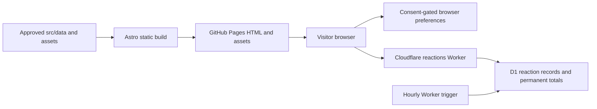

# Daysforth architecture

This is the maintained description of the running system, not a proposal for a larger platform.
Read it with [the architectural review](review.md), [maintenance rules](maintenance.md), and
[release process](../governance/releases.md). Source and tests remain authoritative for exact behavior.

## System boundaries

The site has two deployment units. GitHub Pages serves static HTML, CSS, JavaScript, fonts, and images.
A separate Cloudflare Worker and D1 database provide shared reaction counts. The website is readable
without JavaScript or the Worker; local saves and enhanced browsing require JavaScript. No visitor
account, application session server, analytics service, service worker, or uploaded-content pipeline
exists in this architecture.

## Source responsibilities

| Boundary                        | Owns                                                                                | Must not own                                                    |
| ------------------------------- | ----------------------------------------------------------------------------------- | --------------------------------------------------------------- |
| `src/data/`                     | Approved personal content, timeline IDs, photo references, policy and release copy  | DOM behavior, unconfirmed facts, secrets                        |
| `src/pages/`, `src/components/` | Static routes, semantic HTML, responsive presentation                               | Independent copies of personal content or behavioral algorithms |
| `src/layouts/BaseLayout.astro`  | Shared landmarks, metadata integration, dialogs and client entry                    | Individual page content                                         |
| `src/lib/`                      | Tested date/model/URL functions, browser controls, reaction wire client and service | Deployment credentials or invented content                      |
| `src/scripts/`                  | Small progressive-enhancement entry points and deferred loading                     | A second domain model                                           |
| `src/styles/`                   | Feature-owned presentation, responsive states, and shared interface foundations     | Competing global overrides of another feature’s layout          |
| `scripts/`, `scripts/lib/`      | Thin CLI entry points and tested repository policies                                | Site runtime behavior                                           |
| `workers/reactions/`            | Worker binding adapter, D1 migrations, scheduled cleanup, deployment config         | Raw visitor identifiers in storage or production secrets in Git |
| `tests/`                        | Unit behavior/coverage, built-output integrity, real-browser checks                 | Relaxed production constraints to accommodate failures          |

`src/lib/` contains both browser and Worker code, but they have separate import roots. The browser
starts at `src/scripts/site.ts`; the Worker starts at `workers/reactions/src/index.ts`. Keep
`reaction-service.ts` and its database interface out of the browser graph. Conversely, Worker code
must not import DOM controllers, Astro image transforms, or browser storage.

`npm run check:repo` enforces this separation through the first-party dependency graph. It follows
runtime static imports, literal deferred imports, and re-exports from browser entry points,
DOM-capability modules, Astro browser scripts, and Worker entry points. Type-only imports are erased
and do not connect runtime graphs. Browser code cannot reach the reaction database service, Node
built-ins, repository tools, or Astro build APIs; Workers cannot reach DOM/browser controllers or
site-build capabilities. Libraries cannot import their executable entry adapters. Computed imports
and CommonJS `require` are rejected in those runtime graphs so loading remains reviewable.

The gate complements TypeScript, bundling, and browser/service tests. It inspects first-party source,
not third-party package internals or arbitrary aliases/reflection. DOM detection covers explicit DOM
types and `document`, `window`, and browser-storage globals, including `globalThis` access. Review
changes to runtime resolution, aliases, unusual embedded scripts, or new platform capabilities
alongside the gate; do not weaken the boundary to accommodate an accidental dependency.

## Rendering and navigation

Astro produces real URLs at build time, including `/posts/<id>/`, `/releases/`, and
`/releases/<version>/`. Content aliases retain retired post URLs. `BaseLayout` supplies one shared
document shell. Astro computes CSP hashes for bundled scripts/styles; local fonts and responsive
images are emitted with the site. `deploy-config.ts` and `paths.ts` keep canonical URLs and asset
paths correct for either the custom domain root or GitHub Pages project subpaths.

The chronological model and date calculations are shared by server rendering and client browsing.
Client controllers enhance already rendered cards, synchronize filters and dates with URL/history
state, and restore the visitor’s place. Query state is shareable; `history.state` scroll coordinates
belong to a browser entry. They are not a server browsing profile. Dialog and action code loads on
intent to control the script budget.

## Persistence and trust

`consent.ts` separates a necessary expiring consent record from optional preferences. Theme, saves,
and reaction choices use memory until permission; storage reads/writes handle unavailable browser
storage. Privacy controls can withdraw persistence and clear application preferences. Browser
preferences are not a backup or a cross-device account.

The browser calls the public reaction endpoint configured through `PUBLIC_REACTIONS_URL`. That
value is public build configuration. `RATE_LIMIT_SALT` is a Worker secret and D1 is a private service
binding. The service validates methods, routes, origin, body size, and visitor IDs before mutation;
parameterized SQL and database uniqueness make votes idempotent while aggregate totals stay
permanent. An hourly trigger removes expired network limit records and reaction identifiers eligible
after 90 days. Identifier removal does not undo a published count.

Origin/CORS checks govern browsers; they are not account authentication. A person can clear storage
and obtain another identifier. Reaction totals are lightweight social signals, not a ballot,
identity proof, analytics measure, or fraud-resistant counter. Hashed identifiers are pseudonymous,
not a claim of anonymization.

## Release and delivery

`package.json` is the canonical product version. `src/data/releases.ts` reads it for the UI and keeps
permanent historical visitor notes. The lockfile must agree. CI checks source quality, full per-file
unit coverage, built pages and budgets at root/subpath, browser behavior/accessibility, and security.
The Pages deployment workflow builds and verifies the exact publication address after the quality
gate. A Worker/schema change is released separately and needs its own deployment verification.

Only Carson performs the owner-controlled release actions described in repository rules, unless
he explicitly authorizes an action. A Git tag describes a source release; it does not by itself
prove that either live deployment has changed. Do not put an unverified deployment date in notes.
